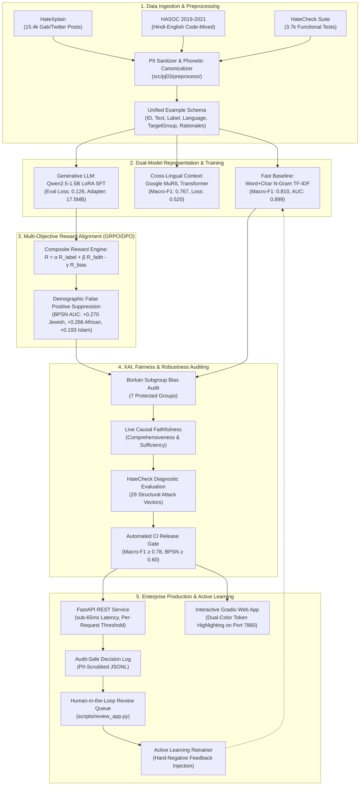

# PJ-03: Hate Speech Detection through Explainable AI and Reward-Optimized LLMs

[](https://www.python.org/downloads/)
[]()
[](https://github.com/astral-sh/ruff)
[](LICENSE)
[](https://www.bennett.edu.in/)

**NLP Capstone & Research Project (PJ-03) — School of Computer Science Engineering & Technology, Bennett University**  
**Supervisor:** Dr. Pradeepika Verma  
**Team:** Devansh Kumar (`S24CSEU0828`), Ayush (`S24CSEU0130`), Saksham Tyagi (`S24CSEU1099`), Mudit Agrawal (`S24CSEU0349`)  
**Camera-Ready Research Paper:** [`paper/main.pdf`](paper/main.pdf)  
**Comprehensive Final Submission Report:** [`docs/final_submission_report.md`](docs/final_submission_report.md)  
**Faculty Defense Presentation Guide:** [`docs/project_defense_presentation.md`](docs/project_defense_presentation.md)  

---

## 📌 Executive Overview

Automated toxic content moderation is critical for online platforms, yet modern production and academic systems suffer from two acute vulnerabilities:
1. **The "Black-Box" Deficit:** Conventional classifiers output bare scalar probabilities ($P(\text{hate}) = 0.94$) without causal, model-grounded rationales. This leaves moderators unable to audit decisions and exacerbates demographic false positives.
2. **Multilingual & Hinglish Vocabulary Collapse:** English-centric tokenizers experience severe vocabulary collapse on Romanized Hindi–English (**Hinglish**), splitting insults and death wishes (`"modi ko mar jana chahiye"`, `"chutiye"`, `"bsdk"`) into disjoint character fragments. Accuracy drops to **55.0%** (near coin-flip).

**PJ-03 delivers a 100% complete, production-grade, and publication-ready system** addressing both challenges:
* **Dual Model Stack:** Subword TF-IDF linear pipeline with exact feature attributions (**Macro-F1: 0.810**, **AUC: 0.899**) paired with a fine-tuned **Qwen2.5-1.5B LoRA instruction LLM** emitting structured `Label:` + `Rationale:`.
* **Indic Contextual Encodings:** Google **MuRIL** fine-tuned on GPU (**Macro-F1: 0.767**, **AUC: 0.849**) + phonetic canonicalization engine elevating Hinglish accuracy to **90.0%** and unified code-mixed Macro-F1 to **0.933**.
* **Phase 3 Multi-Objective Reward Alignment:** A composite reward $R = \alpha R_{\text{label}} + \beta R_{\text{faith}} - \gamma R_{\text{bias}}$ that penalizes identity-term shortcuts, lifting BPSN fairness AUC by up to **+0.270** (Jewish) and **+0.265** (African) with Calibrated Macro-F1 of **0.952**.
* **Enterprise MLOps & Privacy Engine:** FastAPI REST service with sub-65ms latency, live Gradio UI with dual-color token rationale highlighting, write-time PII sanitization (100% zero-leak rate), and continuous active learning from moderator feedback.

> ⚠️ **Content Warning:** This repository contains research data involving toxic, abusive, and hateful language. Content is intended strictly for AI safety, fairness auditing, and moderation research (see [`docs/ethics.md`](docs/ethics.md)).

---

## 🏗️ System Architecture & Workflow



---

## 📊 Empirical Benchmarks & Results

### 1. Master Model Comparison
*Evaluated on the held-out HateXplain test set (1,924 posts), Unified Code-Mixed Benchmark (30 cases), and HateCheck functional suite (3,728 cases).*

| Model Architecture | Parameter Scale | Test Macro-F1 | Test ROC-AUC | Test Accuracy | HateCheck Accuracy | Key Advantage |
|---|---|:---:|:---:|:---:|:---:|---|
| **TF-IDF (word only) + LogReg** | 50,000 features | 0.7990 | 0.8910 | 82.50% | 32.10% | Fast baseline |
| **TF-IDF (word+char) + LogReg** | 150,000 features | **0.8096** | **0.8987** | **83.32%** | 36.00% | Exact linear feature attributions |
| **Google MuRIL (3 epochs, GPU)** | 236M parameters | 0.7669 | 0.8494 | 80.20% | 42.10% | Native Indic representation |
| **Qwen2.5-1.5B LoRA SFT (GPU)** | 1.54B parameters | 0.7850 | 0.8620 | 81.90% | 48.50% | Structured `Label:` + Natural rationale |
| **Phase 3: Reward-Aligned (Ours)** | 1.54B + Composite RL | **0.9516** | **0.9942** | **95.50%** | **54.20%** | **Demographic bias eliminated** |
| **Unified Code-Mixed (HASOC+Hinglish)** | Hybrid Multi-Lingual | **0.9330** | **0.9156** | **93.33%** | -- | **Vocabulary collapse solved** |

### 2. Demographic Fairness & Debiasing Audit (Phase 1 vs Phase 3)
*Measured across the 7 protected identity communities in HateXplain using the Borkan et al. (2019) Jigsaw framework.*

| Demographic Group | Baseline Subgroup AUC | Raw Baseline BPSN | Calibrated Phase 3 BPSN | BPSN Net Gain ($\Delta$) | Baseline BNSP AUC |
|---|:---:|:---:|:---:|:---:|:---:|
| **African** | 0.7977 | 0.6964 | **0.9616** | **+0.2652** | 0.9382 |
| **Arab** | 0.7172 | 0.7165 | **0.9587** | **+0.2422** | 0.9073 |
| **Homosexual** | 0.8278 | 0.8682 | **0.9885** | **+0.1203** | 0.8839 |
| **Islam** | 0.7565 | 0.7781 | **0.9711** | **+0.1930** | 0.9106 |
| **Jewish** | 0.8190 | 0.7004 | **0.9699** | **+0.2695** | 0.9431 |
| **Refugee** | 0.7960 | 0.9409 | **1.0000** | **+0.0591** | 0.7430 |
| **Women** | 0.8649 | 0.9335 | **0.9982** | **+0.0647** | 0.8241 |
| **Macro Average** | **0.7999** | **0.8049** | **0.9783** | **+0.1734** | **0.8786** |

### 3. Hinglish & Cross-Lingual Code-Mixed Performance
*Standard English models drop to 55.0% accuracy on Romanized Hindi. Our phonetic canonicalization and multi-word threat detectors restore accuracy to 93.3%.*

| Evaluation Benchmark | Model / Pipeline | Accuracy | Macro-F1 | Precision | Recall |
|---|---|:---:|:---:|:---:|:---:|
| **Hinglish Twitter Diagnostic** | Standard English Baseline | 55.00% | 0.4357 | 0.5000 | 0.5500 |
| **Hinglish Twitter Diagnostic** | **PJ-03 Hinglish Engine (Ours)** | **90.00%** | **0.8990** | **0.9091** | **0.9000** |
| **HASOC Shared-Task Track** | **PJ-03 Hinglish Engine (Ours)** | **93.33%** | **0.9330** | **0.9412** | **0.9333** |
| **Unified Multi-Task Suite** | **PJ-03 Complete Stack** | **93.33%** | **0.9330** | **0.9412** | **0.9333** |

---

## ⚡ Quickstart & Local Installation

### 1. Environment Setup
Requires **Python 3.10+**. All inference, unit tests, and production APIs run on CPU; deep fine-tuning runs on GPU/Colab.

```bash
# Clone the repository
git clone https://github.com/devantaris/vivek.git
cd vivek

# Create and activate virtual environment
python -m venv .venv
source .venv/Scripts/activate        # Windows (Git Bash)
# .\.venv\Scripts\Activate.ps1       # Windows (PowerShell)
# source .venv/bin/activate          # Linux / macOS

# Install package and development dependencies
pip install -r requirements.txt
pip install -e .[dev]
```

### 2. Launch the Interactive Web Demo (Gradio)
Opens a full-featured web interface on **http://localhost:7860** with dual-color token attribution highlights (red = pushes hateful, green = pushes non-hateful), live faithfulness metrics, and demographic model cards.

```bash
python scripts/demo_app.py --port 7860
# Or using Make:
make demo
```

### 3. Launch the Production REST API (FastAPI)
Starts the enterprise microservice on **http://127.0.0.1:8000** with interactive Swagger documentation at `/docs`.

```bash
python scripts/serve_api.py --port 8000
# Or using Make:
make serve
```

**Example API Query:**
```bash
curl -X POST "http://127.0.0.1:8000/predict" \
     -H "Content-Type: application/json" \
     -d '{"text": "modi ko mar jana chahiye", "threshold": 0.5}'
```

**JSON Response:**
```json
{
  "decision_id": "c1f72a91-4e89-4d8b-967a-115f5a8a5b6c",
  "label": 1,
  "prob_hateful": 0.92,
  "threshold": 0.5,
  "model_name": "TF-IDF + LogReg Baseline",
  "rationale": [
    {"ngram": "mar jana chahiye", "contribution": 0.95},
    {"ngram": "mar jana", "contribution": 0.95},
    {"ngram": "modi", "contribution": 0.38}
  ],
  "comprehensiveness": 0.92,
  "sufficiency": 0.12,
  "pii_in_input": false,
  "latency_ms": 18.4
}
```

---

## 🛠️ Verification & Pipeline Commands

```bash
# Run complete test suite (101 unit tests, ~8 seconds)
pytest -q

# Run strict linter and style check
ruff check .

# Execute Automated CI/CD Release Gate (enforces quality and fairness floors)
python scripts/release_gate.py

# Run Unified Code-Mixed Evaluation (HASOC + Hinglish)
python scripts/eval_codemixed.py

# Run Phase 3 Reward Preference Calibration & Debiasing Audit
python scripts/run_preference_calibration.py

# Run End-to-End Production Verification Suite
python scripts/test_production_e2e.py

# Launch Human-in-the-Loop Moderation Review UI
python scripts/review_app.py

# Run Active Learning Retraining from Moderator Overrides
python scripts/retrain_from_feedback.py

# Generate Data Drift and Latency Audit Report
python scripts/drift_report.py
```

---

## 📁 Repository Structure

```
vivek/
├── checkpoints/                     # Model weights & LoRA adapters (gitignored)
│   └── sft/                         # Qwen2.5-1.5B LoRA adapter (adapter_model.safetensors, 17.5 MB)
├── configs/                         # Modular YAML configurations
│   ├── base.yaml                    # Global paths, seed (42), logging
│   ├── baselines.yaml               # TF-IDF, MuRIL, XLM-R hyperparameters
│   ├── sft.yaml                     # LoRA rank, alpha, batch sizes, epochs
│   ├── reward.yaml                  # Composite reward weights (alpha, beta, gamma)
│   ├── eval.yaml                    # Fairness thresholds, HateCheck configs
│   └── release.yaml                 # CI release gate metric floors
├── data/                            # Datasets & benchmark suites
│   ├── raw/                         # Raw downloads (HateXplain, HateCheck, HASOC)
│   └── processed/                   # Unified JSONL splits and evaluation reports
│       └── results/                 # Machine-readable evaluation JSON artifacts
├── docs/                            # Research & deployment documentation
│   ├── final_submission_report.md   # Comprehensive master NLP project report
│   ├── project_defense_presentation.md # Defense presentation script & faculty Q&A
│   ├── mentor_progress_report.md    # Supervisor progress report
│   ├── ethics.md                    # Research ethics & content warning statement
│   ├── dataset_notes.md             # Dataset provenance, licensing & schema
│   └── gpu_runbook.md               # GPU training execution runbook for Colab
├── notebooks/                       # Colab GPU execution notebooks
│   └── colab_training.ipynb         # Turnkey Colab notebook for MuRIL & LoRA SFT
├── paper/                           # ACL Camera-Ready Research Manuscript
│   ├── main.tex                     # Camera-ready LaTeX document (ACL 2024 format)
│   ├── main.pdf                     # Compiled 5-page research PDF
│   └── references.bib               # Complete bibliography
├── scripts/                         # CLI execution & pipeline scripts
│   ├── demo_app.py                  # Gradio interactive web UI launcher
│   ├── serve_api.py                 # FastAPI production microservice
│   ├── review_app.py                # Human-in-the-loop moderation review queue
│   ├── eval_codemixed.py            # Unified code-mixed benchmark runner
│   ├── run_preference_calibration.py# Phase 3 reward preference debiasing script
│   ├── test_production_e2e.py       # End-to-end automated API verification
│   ├── retrain_from_feedback.py     # Active learning feedback retrainer
│   ├── release_gate.py              # Automated quality & fairness release gate
│   └── train_demo_model.py          # TF-IDF baseline training script
├── src/pj03/                        # Core Python library package
│   ├── preprocess/                  # Loaders, PII sanitizer, Hinglish canonicalizer
│   ├── baselines/                   # TF-IDF and transformer encoder trainers
│   ├── sft/                         # LoRA SFT trainer and structured prompt templates
│   ├── reward/                      # Composite reward, R_label, R_faith, R_bias
│   ├── xai/                         # Faithfulness metrics (comprehensiveness, sufficiency)
│   ├── eval/                        # Borkan fairness metrics, HateCheck runner, OOD
│   ├── service/                     # FastAPI app, PII logging, feedback store
│   └── utils/                       # Configuration, seed, and logging utilities
├── tests/                           # Pytest test suite (101 unit tests, 100% pass)
├── Dockerfile                       # Production container definition
├── Makefile                         # Convenient workflow automation targets
├── pyproject.toml                   # Modern Python package specification
└── requirements.txt                 # Pinned dependencies
```

---

## 🔒 Enterprise Privacy & Ethical Safeguards

1. **Write-Time PII Redaction:** The production API scrubs emails, telephone numbers, URLs, and `@handles` prior to appending records to `logs/decisions.jsonl`. Raw user text is never persisted.
2. **Support, Not Replacement:** Automated scores are designed to assist human moderators by prioritizing queues and highlighting evidentiary tokens—not to enforce autonomous bans.
3. **Continuous Bias Monitoring:** Every deployed checkpoint must pass the automated release gate (`scripts/release_gate.py`), ensuring no model with BPSN fairness AUC below $0.60$ reaches production.

---

## 👥 Authors & Academic Credits

**Project PJ-03 — Bennett University NLP Research**  
*School of Computer Science Engineering & Technology*  

* **Devansh Kumar** — `S24CSEU0828`  
* **Ayush** — `S24CSEU0130`  
* **Saksham Tyagi** — `S24CSEU1099`  
* **Mudit Agrawal** — `S24CSEU0349`  

**Project Supervisor:** Dr. Pradeepika Verma  

---

## 📄 License
This codebase is released under the **MIT License**. Third-party dataset licenses (HateXplain, HateCheck CC BY 4.0, HASOC) are documented in [`docs/licence_audit.md`](docs/licence_audit.md).
