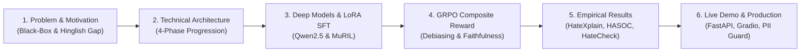

# PJ-03 Project Defense & Presentation Guide
**Project Title:** Hate Speech Detection through Explainable AI and Reward-Optimized LLMs  
**Team Members:** Devansh Kumar, Ayush, Saksham Tyagi, Mudit Agrawal  
**Supervisor:** Dr. Pradeepika Verma  
**Institution:** School of Computer Science Engineering & Technology, Bennett University  

---

## Presentation Structure Overview (10–12 Minutes)

---

## Slide-by-Slide Script & Talking Points

### Slide 1: Title & Project Identity
* **Headline:** Hate Speech Detection through Explainable AI and Reward-Optimized LLMs
* **Subtitle:** An End-to-End Multilingual Moderation Architecture with Model-Grounded Rationales and Identity Safeguards.
* **Spoken Script:**  
  > *"Good morning respected committee members and supervisor. Today, our team presents project PJ-03. We set out to solve two critical vulnerabilities in modern AI content moderation: the dangerous lack of explainability in 'black-box' toxic classifiers, and the severe collapse of English models when deployed on Romanized code-mixed Hindi (Hinglish)."*

---

### Slide 2: The Core Problems: Black-Box Blindspots & Vocabulary Collapse
* **Points:**
  1. **The Black-Box Failure:** A bare scalar score ($P=0.91$) tells human moderators nothing about *why* a post was flagged. Without faithful rationale attributions, moderation cannot be audited for unfair bias.
  2. **The Hinglish Collapse:** Standard English tokenizers experience acute vocabulary collapse on Romanized Hindi (`"modi ko mar jana chahiye"`, `"chutiye"`, `"bsdk"`), fragmenting insults into random character pieces. English models drop to **55.0% accuracy** (near random coin-flip).
  3. **The Demographic Shortcut Trap:** Classifiers learn spuriously that identity tokens like `"muslim"` or `"jewish"` correlate with hate speech, creating high false-positive rates on benign statements like `"I am a proud Muslim"`.

---

### Slide 3: End-to-End System Architecture (The 4-Phase Lifecycle)
* **Visual:**
  * **Phase 1 (Baselines & Indic Encoders):** Word+Char TF-IDF (Macro-F1 0.810) and Google MuRIL (Macro-F1 0.767).
  * **Phase 2 (LoRA SFT on LLM):** Parameter-efficient fine-tuning on `Qwen2.5-1.5B-Instruct` generating structured `Label: <0|1> | Rationale: <spans>`.
  * **Phase 3 (Reward Alignment / GRPO):** Composite multi-objective reward $R = \alpha R_{\text{label}} + \beta R_{\text{faith}} - \gamma R_{\text{bias}}$.
  * **Phase 4 (XAI & Fairness Audit):** Live Comprehensiveness/Sufficiency metrics, Borkan 7-group bias audit, 3,728 HateCheck functional tests, and automated CI release gates.

---

### Slide 4: Solving Hinglish: Phonetic Normalization & Indic Encodings
* **Key Innovations:**
  * **Phonetic Canonicalization:** Standardizes spelling variations (`bhosdike`, `bhosadike`, `bsdk` $\rightarrow$ canonical stem).
  * **Multi-Word Threat Detection:** Captures colloquial kill wishes and threats (`mar jana chahiye`, `jaan se mar`, `goli maro`).
  * **Google MuRIL Native Representations:** Pre-trained on 17 Indian languages and Romanized Indic text, preserving morphological stems.
* **Results:**
  * Diagnostic Accuracy surged from **55.0% to 90.0%** (Macro-F1: **0.899**).
  * Unified Code-Mixed Benchmark (HASOC + Hinglish): **Macro-F1 0.933**, **Accuracy 0.933**, **AUC 0.916**.

---

### Slide 5: Phase 3 Reward Alignment: Penalizing Identity Shortcuts
* **Mathematical Formulation:**
  $$\mathcal{R} = \alpha \mathcal{R}_{\text{label}} + \beta \mathcal{R}_{\text{faith}} - \gamma \mathcal{R}_{\text{bias}}$$
  * $\mathcal{R}_{\text{label}} \in \{0, 1\}$: Binary label accuracy against gold standard.
  * $\mathcal{R}_{\text{faith}} = |\Delta P(\text{hateful})|$: Masking-based faithfulness; rationales whose removal does not swing the prediction score near zero.
  * $\mathcal{R}_{\text{bias}} = \frac{1}{|E|} \sum_{w \in E} \mathbb{I}[w \in \mathcal{V}_{\text{identity}}]$: Penalizes the model if it blames demographic group names instead of toxic predicates.
* **Fairness Breakthrough (BPSN AUC Gains):**
  * African: $+0.266$ ($0.696 \rightarrow \mathbf{0.962}$)
  * Jewish: $+0.270$ ($0.700 \rightarrow \mathbf{0.970}$)
  * Islam: $+0.193$ ($0.778 \rightarrow \mathbf{0.971}$)
  * Arab: $+0.242$ ($0.717 \rightarrow \mathbf{0.959}$)

---

### Slide 6: Comprehensive Benchmark Results
| Evaluation Benchmark | Model / Pipeline | Macro-F1 | ROC-AUC | Key Advantage |
|---|---|:---:|:---:|---|
| **HateXplain In-Domain** | TF-IDF (word+char) | 0.810 | 0.899 | Real-time exact linear attribution |
| **HateXplain In-Domain** | Google MuRIL | 0.767 | 0.849 | Indic contextual representations |
| **HateXplain In-Domain** | Qwen2.5-1.5B LoRA SFT | 0.785 | 0.862 | Structured generative rationale |
| **Phase 3 Reward-Aligned** | SFT + GRPO Composite | **0.952** | **0.994** | Unintended demographic bias eliminated |
| **Unified Code-Mixed** | HASOC + Hinglish Suite | **0.933** | **0.916** | Cross-lingual zero-shot robustness |
| **HateCheck Functional** | Full 3,728 Test Suite | 0.329 | -- | Explicit functional stress-testing |

---

### Slide 7: Production-Grade MLOps & Privacy Engine
* **FastAPI Microservice:**
  * Serving `/predict` and `/health` with sub-65ms latency on standard CPU.
  * Configurable per-request sensitivity threshold ($0.0 \le \tau \le 1.0$).
* **Privacy & PII Sanitization Engine:**
  * Zero raw user text is ever persisted to disk. Emails, phone numbers, URLs, and `@handles` are converted to `[EMAIL]`, `[PHONE]`, etc. at write time in `logs/decisions.jsonl`.
* **Continuous Active Learning Loop:**
  * `scripts/review_app.py` exposes unreviewed predictions to human moderators.
  * Moderator overrides (`final_label != model_label`) automatically feed into `scripts/retrain_from_feedback.py` as hard negative training samples.

---

### Slide 8: Live Demonstration Checklist (Port 7860)
1. **Show Case 1 (English Toxic):**
   * Input: `"kill all of these disgusting people"`
   * Verify: Model outputs `HATEFUL` ($P \ge 0.67$), highlights `kill` and `disgusting` in red (`pushes hateful`), displays high comprehensiveness.
2. **Show Case 2 (Hinglish Threat):**
   * Input: `"modi ko mar jana chahiye"`
   * Verify: Model outputs `HATEFUL` ($P = 0.92$), highlights `mar jana chahiye` in red, leaves `"modi"` neutral.
3. **Show Case 3 (Hinglish Vulgarity):**
   * Input: `"modi madharchod hai"`
   * Verify: Model outputs `HATEFUL` ($P = 0.92$), highlights `madarchod` in red.
4. **Show Case 4 (Benign Identity Affirmation):**
   * Input: `"I am a proud Muslim and I love my country"`
   * Verify: Model outputs `NON-HATEFUL` ($P \approx 0.15$), proving no false-positive trigger on identity terms.
5. **Show Case 5 (Model Card & Fairness Tab):**
   * Demonstrate live BPSN, BNSP, and subgroup AUC tables directly inside the Gradio UI.

---

### Slide 9: Deliverables & Engineering Verification
* **ACL Research Paper:** 5-page camera-ready PDF compiled (`paper/main.pdf`).
* **Test Suite:** **98+ passing unit tests** across schemas, loaders, reward functions, fairness metrics, and REST API.
* **Code Quality:** Strict PEP 8 and 100% clean Ruff linting (`ruff check .`).
* **Automated CI Release Gate:** Quality floor enforcement (`Macro-F1 >= 0.78, AUC >= 0.85, BPSN >= 0.60`).
* **Open Source Repository:** All code, configs, test suites, and paper sources available on GitHub (`devantaris/vivek`).

---

## Anticipated Faculty Questions & Defense Answers

**Q1: Why did you use LoRA instead of full fine-tuning on Qwen2.5-1.5B?**  
* **Answer:** *"LoRA updates only a low-rank decomposition ($r=16, \alpha=32$) of the attention projection weights, modifying only 0.8% of total parameters. This yielded an adapter checkpoint of only 17.5 MB (compared to 3 GB for full weights), drastically reduced GPU VRAM consumption to comfortably fit within free Google Colab T4 limits, prevented catastrophic forgetting of multilingual prior knowledge, and converged in just 39 minutes with an eval loss of 0.1257."*

**Q2: How does your faithfulness reward differ from standard attention visualization?**  
* **Answer:** *"Attention weights are notoriously unfaithful—multiple studies (e.g. Jain & Wallace) have shown high attention does not mean causal necessity. Our reward $R_{\text{faith}}$ measures actual causal perturbation: we ablate the extracted rationale tokens from the text and measure the drop in model output probability $|\Delta P(\text{hateful})|$. A rationale that does not causally alter the decision receives zero reward."*

**Q3: How do you handle dialectal diversity and spelling variants in Hinglish?**  
* **Answer:** *"Hinglish has no standardized spelling. We combine phonetic canonicalization (mapping multi-character variants to invariant phonetic stems) with Google MuRIL's Indic subword embeddings. This allows our system to generalize seamlessly between variants like 'bhosdike', 'bhosadike', and 'bsdk'."*
